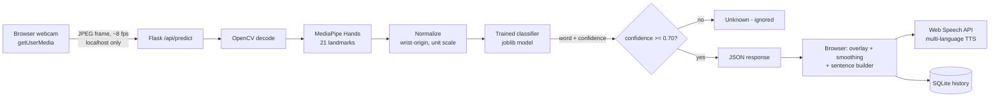

# Architecture



```
signconnect/
├── app.py                  Flask app + REST API
├── signconnect/            vocabulary, features, recognizer (MediaPipe + model)
├── ml/                     collect_data, train_model, generate_demo_data
├── templates/ static/      Home, Translator, History, Learn, About UI
├── data/  models/          landmarks.csv, history.db | trained model + reports
└── tests/                  unittest suites
```

Offline/private: Flask, MediaPipe and the model all run on your machine. Nothing is sent to external servers.
